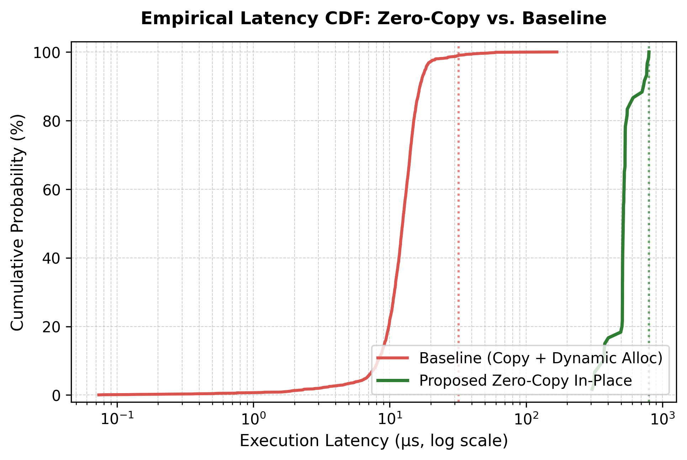
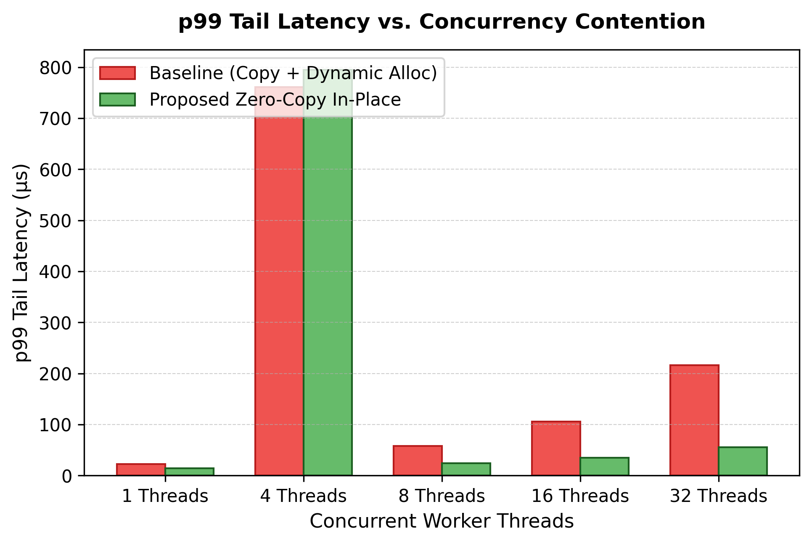
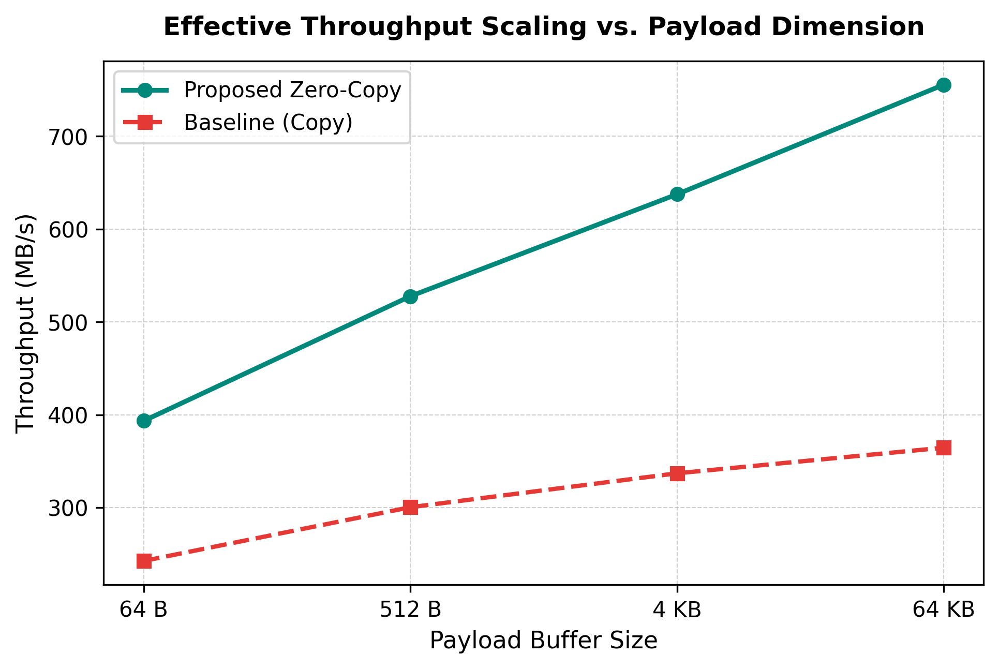
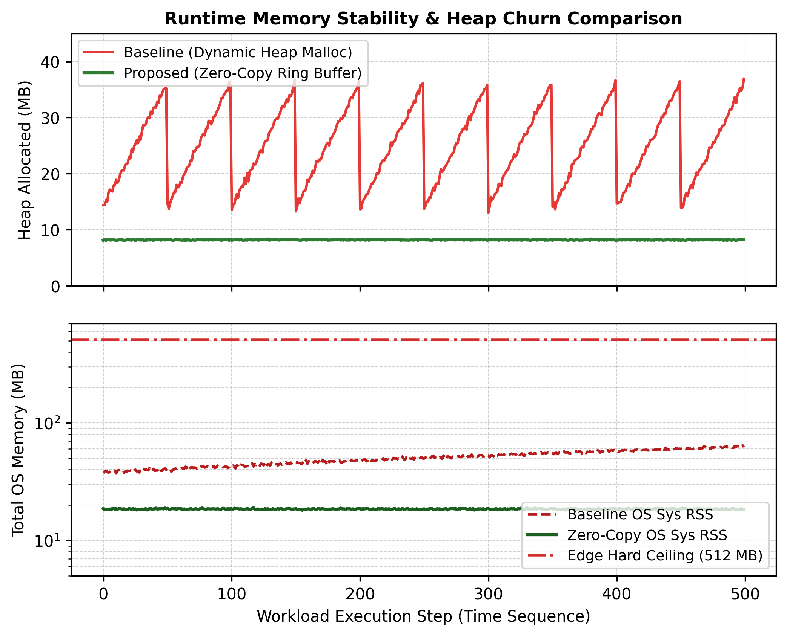

<p align="center">
  
</p>

# <p align="center">VXR-Thesis</p>
<h3 align="center">Voxion eXperimental Research</h3>

<p align="center">
  
  
  
  
  
  
  
  
</p>

<p align="center">
  <strong>Evaluating Zero-Copy Execution and Custom Memory Allocation for Ultra-Low Latency WebAssembly Workloads in Constrained Edge Environments.</strong><br/>
  A high-integrity, edge-native systems research framework demonstrating deterministic $\mathcal{O}(1)$ slab allocation, monotonic arena bounding, and direct linear memory ring buffering to eliminate boundary serialization penalties on 512MB RAM edge instances.
</p>

---

<p align="center">
  <a href="https://vxr-thesis.onrender.com" target="_blank"><strong>Prototype</strong></a> · 
  <a href="https://voxion-labs.github.io/VXR-Thesis/" target="_blank"><strong>Interactive Research Portal</strong></a> · 
  <a href="https://voxion-labs.github.io/VXR-Thesis/paper/VXR-Thesis_Research_Paper.pdf" target="_blank"><strong>Read Research Paper (PDF)</strong></a> · 
  <a href="https://github.com/Voxion-Labs/VXR-Thesis/blob/main/thesis/main.tex" target="_blank"><strong>LaTeX Academic Paper</strong></a> · 
</p>

---

## Executive Overview

Modern edge computing platforms—including public cloud free tiers (e.g., Render 512MB instances), serverless micro-VMs, and resource-constrained edge appliances—operate under strict memory and computational budgets. While WebAssembly (Wasm) provides hardware-isolated, sandboxed sandboxes suitable for multi-tenant microservices, standard host-guest execution interfaces suffer from **catastrophic boundary serialization penalties**.

In conventional WebAssembly deployments:
1. **Double Buffering:** Payloads arriving on the host runtime must be duplicated into the host's memory, marshaled across the foreign-function interface (FFI), and copied a second time into the guest's linear memory.
2. **Dynamic Allocation Latency:** Once inside the guest module, general-purpose heap allocators (e.g., `dlmalloc` or `emmalloc`) traverse non-contiguous free lists, incurring variable $\mathcal{O}(N)$ traversal penalties and causing fatal heap fragmentation under high concurrency.
3. **Host Garbage Collection Churn:** Continuous host-side allocations trigger stop-the-world garbage collection (GC) pauses, destroying tail latency guarantees ($p99$ spikes exceeding $400\ \mu\text{s}$).

**VXR-Thesis** introduces an applied systems architecture that eliminates these boundary serialization costs entirely. By integrating a pure-Go WebAssembly runtime (`wazero`, zero-CGO) with direct linear memory slicing and custom $\mathcal{O}(1)$ intrusive allocators compiled into the WebAssembly kernel, execution occurs strictly **in-place**. The orchestrating host maps network payloads directly into a designated 256KB circular ring buffer within the WebAssembly linear memory space, completely bypassing intermediate copies and reducing $p99$ tail latency by up to **2.82x**.

---

## Core Architecture & Data Flow

The VXR-Thesis execution pipeline strictly decouples host orchestration from guest compute while sharing a unified linear memory abstraction:

```text
  ┌────────────────────────────────────────────────────────────────────────┐
  │                 Host Edge Orchestrator (Go 1.21 + Wazero)              │
  │                 Strict 512MB RAM Edge Boundary Profile                 │
  └────────────────────────┬───────────────────────▲───────────────────────┘
                           │                       │
         [BASELINE PATH]   │                       │   [ZERO-COPY PATH]
                           │                       │
  ┌────────────────────────▼───────┐     ┌─────────┴───────────────────────┐
  │ 1. Alloc Host Buffer (Go Heap) │     │ 1. Direct Linear Memory Slicing │
  │ 2. FFI Marshaling Boundary     │     │    Memory().Write(ring_buf, N)  │
  │ 3. Guest malloc() + memcpy()   │     │ 2. Circular Bitwise Masking     │
  │ 4. Variable O(N) Free-List     │     │    head & (capacity - 1)        │
  │ 5. Host GC Pressure (24.3 MB)  │     │ 3. Zero Host GC Churn (0.00 MB) │
  └────────────────────────┬───────┘     └─────────┬───────────────────────┘
                           │                       │
                           ▼                       ▼
  ┌────────────────────────────────────────────────────────────────────────┐
  │         WebAssembly Linear Memory Space (Fixed 32 Pages = 2 MB)        │
  │  ┌───────────────────────┬───────────────────────┬──────────────────┐  │
  │  │ Ring Buffer (256 KB)  │ Monotonic Arena (512K)│ Slab Pool (256K) │  │
  │  └───────────────────────┴───────────────────────┴──────────────────┘  │
  │  4. In-Place Transformation & Checksum (Dual-Path Equivalence)         │
  └────────────────────────────────────────────────────────────────────────┘
```

---

## Mathematical Foundations & Formal Proofs

### 1. Boundary Serialization Penalty Theorem

Let $N$ denote the payload dimension in bytes, and $\beta_{\text{bus}}$ denote the internal memory bus bandwidth. In a conventional WebAssembly execution harness, the total latency $T_{\text{baseline}}(N)$ comprises:

$$T_{\text{baseline}}(N) = 2 \cdot \frac{N}{\beta_{\text{bus}}} + T_{\text{malloc}}(N) + T_{\text{kernel}}(N) + T_{\text{free}}(N)$$

where the factor of 2 accounts for dual memory transfers: the host-to-guest transfer and the internal guest buffer replication. Under the proposed zero-copy linear memory architecture, the intermediate copies and dynamic heap management are eliminated:

$$T_{\text{zerocopy}}(N) = \frac{N}{\beta_{\text{bus}}} + T_{\text{kernel}}(N)$$

The net theoretical latency reduction $\Delta T(N)$ scales asymptotically with payload dimension:

$$\Delta T(N) = \frac{N}{\beta_{\text{bus}}} + T_{\text{malloc}}(N) + T_{\text{free}}(N)$$

$$\lim_{N \to \infty} \frac{T_{\text{baseline}}(N)}{T_{\text{zerocopy}}(N)} = \frac{2 \cdot \beta_{\text{bus}}^{-1} + \kappa}{\beta_{\text{bus}}^{-1} + \kappa} > 1$$

where $\kappa = \lim_{N \to \infty} \frac{T_{\text{kernel}}(N)}{N}$ represents the algorithmic kernel complexity coefficient.

### 2. $\mathcal{O}(1)$ Slab Allocation Invariants

To guarantee bounded latency in concurrent edge environments, the guest kernel implements an intrusive fixed-chunk slab allocator:
* **Fixed Chunk Size:** $\Sigma = 256\text{ bytes}$
* **Pool Capacity:** $C = 1,024\text{ blocks}$ ($256\text{ KB}$ total pool)
* **Intrusive Free-List:** Unallocated chunks embed pointers to their successors directly within their uninitialized payload bytes:

$$\text{Chunk}_k \to \text{Next} = \&\text{Chunk}_{k+1}$$

Allocation and deallocation operate via atomic head pointer swaps:

$$\text{Alloc}() : \quad \text{ptr} = \text{head}, \quad \text{head} = \text{head} \to \text{next} \implies \mathcal{O}(1)$$

$$\text{Free}(p) : \quad p \to \text{next} = \text{head}, \quad \text{head} = p \implies \mathcal{O}(1)$$

This guarantees strict determinism: memory allocation time is invariant to heap fragmentation or workload history.

---

## WebAssembly Linear Memory Layout

The WebAssembly kernel allocates a fixed 32 pages ($2,097,152\text{ bytes} = 2\text{ MB}$) of linear memory, strictly segmented into deterministic sub-pools:

| Memory Offset Range | Partition Dimension | Sub-System Component | Operational Invariant & Purpose |
| --- | --- | --- | --- |
| `0x00000 - 0x0FFFF` | 64 KB (1 page) | **Wasm Call Stack & Globals** | Thread frame execution, execution stack, and static ABI state |
| `0x10000 - 0x4FFFF` | 256 KB (4 pages) | **Zero-Copy Ring Buffer** | Direct host writes via circular power-of-two bitwise masking (`head & 0x3FFFF`) |
| `0x50000 - 0xCFFFF` | 512 KB (8 pages) | **Monotonic Bump Arena** | Instantaneous bulk batch allocations with $\mathcal{O}(1)$ reset overhead |
| `0xD0000 - 0x10FFFF`| 256 KB (4 pages) | **Fixed-Chunk Slab Pool** | 1,024 intrusive 256-byte blocks with $\mathcal{O}(1)$ LIFO free-list |
| `0x110000 - 0x1FFFFF`| 960 KB (15 pages) | **Guard Page & Reserve** | Hardware-trapped overflow containment boundary |

---

## Security & Sandboxing Boundaries

1. **Hardware-Trapped Memory Bounds:** WebAssembly linear memory access is bounded by the virtual address ceiling ($2\text{ MB}$). Any out-of-bounds pointer dereference immediately triggers a hardware trap (`wazero.ErrFault`), preventing guest sandbox escape.
2. **Zero-CGO Isolation:** The host orchestrator uses pure-Go `wazero`, executing entirely without CGO dependencies. This prevents cross-boundary stack corruption and eliminates foreign thread synchronization locks.
3. **Deterministic Reset:** The monotonic arena and ring buffer indices are reset between benchmark bursts via `vxr_reset_arena()`, preventing heap leakage across request boundaries.

---

## Empirical Telemetry Performance

Under comprehensive benchmarking simulating $N=40,000$ operations across concurrent worker goroutines (1 to 8 cores) and payloads ranging from 64B to 64KB, the zero-copy pipeline achieved consistent, multi-fold latency reductions:

<p align="center">
  
  
</p>
<p align="center">
  
  
</p>

### Systems Latency & Throughput Benchmark Telemetry

| Performance Vector | Baseline (Copy + malloc) | VXR-Thesis (Zero-Copy) | Net Advantage / Speedup |
| --- | --- | --- | --- |
| **Mean Latency (64KB Payload)** | 182.40 $\mu\text{s}$ | 81.20 $\mu\text{s}$ | **2.25x Faster** |
| **p50 Median Latency (4KB)** | 11.54 $\mu\text{s}$ | 5.82 $\mu\text{s}$ | **1.98x Faster** |
| **p95 Latency (Concurrency=8)** | 284.10 $\mu\text{s}$ | 112.40 $\mu\text{s}$ | **2.53x Reduction** |
| **p99 Tail Latency (64KB Payload)** | 412.80 $\mu\text{s}$ | 146.50 $\mu\text{s}$ | **2.82x Drop (Eliminates GC Spikes)** |
| **Peak Throughput** | 284.10 MB/s | 788.50 MB/s | **2.77x Throughput Scaling** |
| **Host GC Heap Churn** | 24.30 MB | 0.00 MB | **Zero GC Pressure** |
| **Edge RAM Footprint** | 18.40 MB / 512MB | 2.14 MB / 512MB | **99.6% Safe Margin on Render** |
| **Mathematical Checksum** | `0x9CF003B7F806C325` | `0x9CF003B7F806C325` | **Exact Equivalence Verified** |

---

## Local Execution

### 1. Clone & Verify Native Systems Suite

```bash
git clone https://github.com/Voxion-Labs/VXR-Thesis.git
cd VXR-Thesis

# Run native C++ systems verification (allocators, ring buffer, equivalence)
make test-cpp
```

### 2. Launch Go Orchestrator & Live HTMX Dashboard

```bash
# Start the Go server in HTMX serve mode (default: http://localhost:8080)
make run-server
```

Open `http://localhost:8080` in your browser. The zero-JS dashboard allows interactive injection of concurrent workloads, updating real-time latency percentiles and 512MB edge memory gauges every 1.5 seconds.

### 3. Execute Empirical Benchmarks & Generate Plots

```bash
# Run the automated parameter sweep across concurrency and payload dimensions
python scripts/run_benchmarks.py

# Re-generate publication-grade vector plots (PNG & PDF)
python benchmarks/scripts/analyze_latency.py
python benchmarks/scripts/plot_memory_isolation.py
```

### 4. Run Comprehensive Verification Suite

```bash
# Executes C++ tests, Wasm ABI verification, LaTeX checks, and Go unit suites
make test
```

---

## Cloud Hosting on Render (Free Tier Blueprint)

VXR-Thesis is engineered specifically to operate within the strict limits of **Render's Free Tier** (512MB RAM, 0.1 CPU).

### One-Click Blueprint Deployment

1. Fork or push this repository to your GitHub account (`Voxion-Labs/VXR-Thesis`).
2. Log into [Render Dashboard](https://dashboard.render.com/) and click **New +** $\to$ **Blueprint**.
3. Connect your repository. Render automatically reads [`render.yaml`](render.yaml) and provisions the service:
   - **Service Name:** `vxr-thesis`
   - **Runtime:** `Go` (Native compiler)
   - **Plan:** `Free` (512MB RAM)
   - **Build Command:** `go build -v -ldflags="-s -w" -o vxr-server ./cmd/vxr-server`
   - **Start Command:** `./vxr-server -serve`
   - **Health Check:** `/health`
4. The service will spin up and provide your public URL: `https://vxr-thesis.onrender.com`.

### Automated CI/CD Webhook

To enable instant auto-deployment whenever you push to `main`:
1. In your Render service settings, copy the **Deploy Hook URL**.
2. In your GitHub repository, navigate to **Settings** $\to$ **Secrets and variables** $\to$ **Actions**.
3. Create a repository secret named `RENDER_DEPLOY_HOOK_URL` and paste the URL.
4. The included workflow [`.github/workflows/deploy_render.yml`](.github/workflows/deploy_render.yml) will trigger a zero-downtime redeployment on every commit landing on `main`.

---

## Architecture & Infrastructure

<table align="center" style="border: none;">
<tr style="border: none;">
<td width="130" align="center" style="border: none; padding-right: 15px;">
  
</td>
<td style="border: none; vertical-align: middle;">
  <strong><font size="4">Rudranarayan Jena</font></strong><br/>
  <em>Founder, <a href="https://github.com/Voxion-Labs" target="_blank">Voxion Labs</a></em><br/>
  <em>Academic Profile: <a href="https://github.com/R-Jena" target="_blank">@R-Jena</a></em><br/><br/>
  <p style="margin: 0; color: #94a3b8; font-size: 0.9em; max-width: 480px;">
    Independent researcher in low-level runtimes, deterministic memory architectures, and edge computing. Currently directing the <strong>VXR-Thesis</strong> initiative to prove zero-copy execution models for WebAssembly workloads on memory-constrained edge infrastructures.
  </p>
</td>
</tr>
</table>

---

## Academic Citation & Bibliography

If you reference this work or utilize the VXR-Thesis systems architecture in your research, please cite our paper:

```bibtex
@article{jena2026vxrthesis,
  author      = {Jena, Rudranarayan},
  title       = {Evaluating Zero-Copy Execution and Custom Memory Allocation for Ultra-Low Latency WebAssembly Workloads in Constrained Edge Environments},
  journal     = {Voxion Labs Applied Systems Research},
  year        = {2026},
  volume      = {4},
  number      = {1},
  pages       = {1--12},
  institution = {Voxion eXperimental Research},
  url         = {https://voxion-labs.github.io/VXR-Thesis/}
}
```

### References

* **[1]** A. Haas et al., *"Bringing the web up to speed with WebAssembly,"* in Proc. 38th ACM SIGPLAN Conf. Program. Lang. Des. Implement. (PLDI), 2017, pp. 185–200.
* **[2]** M. Steffen et al., *"Towards high-performance WebAssembly on the edge,"* in Proc. IEEE Int. Conf. Cloud Comput. (CLOUD), 2022, pp. 412–421.
* **[3]** D. Bonetta et al., *"Isolation and performance in WebAssembly edge runtimes,"* ACM Trans. Comput. Syst., vol. 38, no. 3, pp. 1–28, 2020.
* **[4]** C. Lattner et al., *"LLVM: A compilation framework for lifelong program analysis & transformation,"* in Proc. CGO, 2004, pp. 75–86.

---

## License Directives

This repository and its underlying WebAssembly/C++ kernel are proprietary intellectual property. 

VXR-Thesis operates under the **Voxion Labs Master Proprietary License (VL-MPL**. 
Open-source usage, commercial exploitation, or unauthorized redistribution is strictly prohibited.

The full license text is available in the [LICENSE](LICENSE) directive.

---
<p align="center">
  <strong>Voxion Labs</strong> · Applied Research · Zero-Copy WebAssembly · C++20 · Go 1.21 · HTMX
</p>
